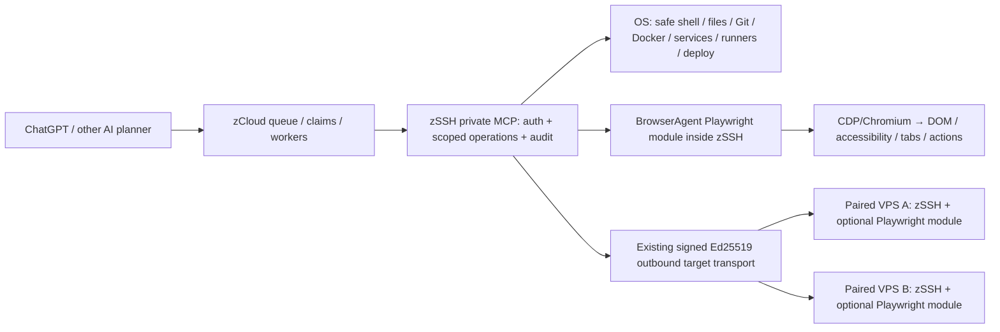

# zCloud execution architecture · zSSH + Browser Agent

Decision: 22 October 2026. **No third standalone VPS-agent service.**

## Ownership

- **zCloud** selects worker tasks and emits a deterministic tool-routing hint in each eligible lane; `project_worker_prompt` includes a compact route when there is an assigned queue item.
- **zSSH** owns target pairing, the private MCP tool `zssh_browser`, signed remote target sessions, host/tool allowlists, command deadlines and audit metadata. The public OAuth plugin is deliberately unchanged: browser tools are private-only.
- **BrowserAgent** is a local Playwright library inside the zSSH service/target agent process. No BrowserAgent HTTP port, queue server, operator dashboard daemon or new VPS agent installer.
- **Browser process** may exist on the target; this is the expected Chrome/Chromium runtime, not another network authorization authority.

## Routing and trust boundary

`capability_route.choose_execution_route(item)` supports metadata `{"execution_capability":"browser"|"system"|"none", "zssh_target_id":"zt_..."}`. If absent, it heuristically chooses browser for DOM/web automation terms or zSSH system for VPS/deployment/system terms. The hint reports `authorized: false` because **routing is not permission**.

`lane_generator.classify_backlog_item` and `generate_execution_lanes` include this advisory `execution_route`. zCloud prompt generation advises `zssh_browser` only for claimed browser tasks; otherwise the existing zSSH tools. No queue record can authorize an arbitrary command or select a privileged account merely by setting metadata. The effective zSSH identity, paired target, allowed domains, restricted OS roots and human approvals remain authoritative.

Browser tasks should batch a few deterministic actions and send only clipped DOM/ARIA/HTML and JSON receipts to the model. Screenshots are not in the default pipeline. Privileged and irreversible browser actions require independently approved single-use receipts. The gateway/target may be offline; no runtime success is inferred from this route metadata.

## Migration and rollout

1. Preserve the existing signed zSSH identity, private gateway and zCloud queue. Do not change the protected public zSSH OAuth gate or self-hosted runner service identities.
2. In each **intended** target's unprivileged zSSH account, prepare a local BrowserAgent checkout with `ops/prepare-zssh-module.sh`. Add explicit allowed domains, `ZSSH_BROWSER_ENABLED=1` and absolute `ZSSH_BROWSER_CAPABILITY_FILE` to the existing private service environment.
3. On a private gateway, optionally set `ZSSH_BROWSER_TARGETS` to explicit already-approved target IDs. For browser operations on a specific paired remote target, include `request.target_id`. Private signed outbound sessions are reused.
4. Perform targeted runtime inspection: zSSH auth succeeds, tool exists only on private profile, browser can start, authorized site navigation yields compact observation, human approval gates deny risky actions until approved. Check zCloud queue route and an actual assigned worker.
5. Deploy using the existing gated zSSH/zCloud process and maintain recovery. No change is automatically applied to the new VPS merely by merging source.

**Known live limitation (22 Oct 2026):** zSSH connector still returned `McpServerError: Session terminated`; source commits/PRs are not proof of service activation. Existing zSSH public onboarding PR #391 has unresolved owner-auth/mTLS deployment gates and must remain separate from this private browser module.
